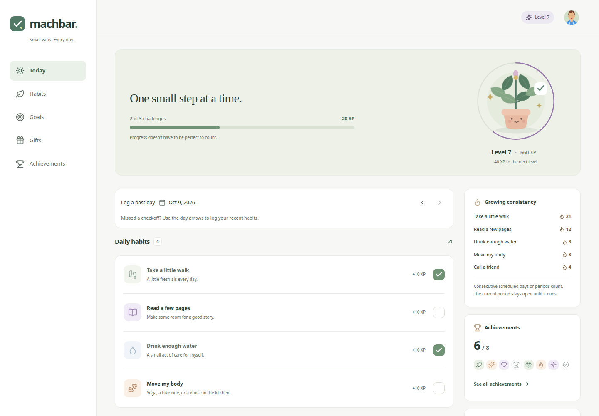
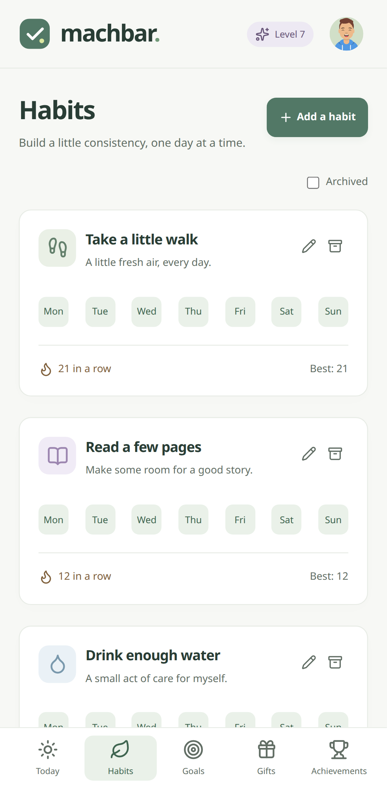
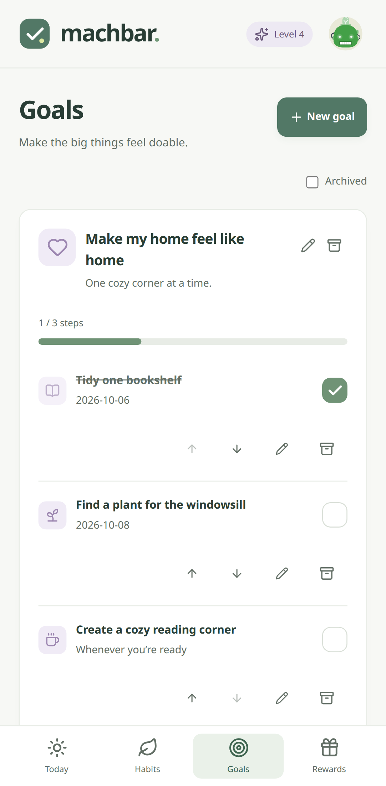
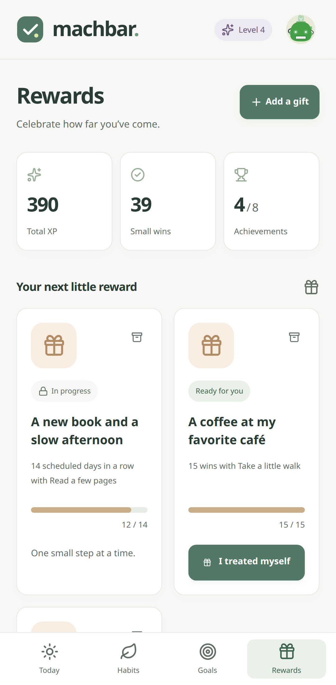
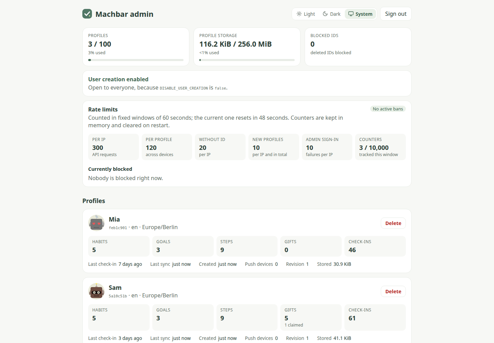

<p align="center">
  
</p>

<h1 align="center">Machbar</h1>

<p align="center"><strong>Small wins. Every day.</strong></p>

Machbar is a self-hosted, mobile-first app for building habits, breaking goals into manageable steps, and rewarding yourself along the way. Check off small wins, grow your streaks, and watch your plant grow with your progress. Install it as a progressive web app (PWA) and keep going offline.

<p align="center">
  <a href="#features">Features</a> ·
  <a href="#screenshots">Screenshots</a> ·
  <a href="#installation">Installation</a> ·
  <a href="#configuration">Configuration</a> ·
  <a href="#maintenance">Maintenance</a> ·
  <a href="#documentation">Documentation</a>
</p>

## Features

- **Flexible habits:** daily, selected weekdays, weekly, monthly, or custom intervals, with streaks, past-day logging, and archiving that keeps your history.
- **Goals in small steps:** dated or undated steps, reordering, and a Today view that brings your next actions together.
- **Progress you can see:** 10 XP per win, a new level every 100 XP, achievement badges, and a growing plant.
- **Rewards for yourself:** unlock gifts by completing a goal, reaching a habit completion count, or building a streak.
- **Offline use and device sync:** edit, check off, and save locally; changes sync automatically when you reconnect, with a sync log and in-app update prompts.
- **No passwords for your profile:** open the same profile on another device by entering its private ID or scanning its QR code.
- **Optional reminders:** Web Push notifications with a reminder time for each habit, goal, and step, plus one-time hints to install the app and turn on notifications.
- **Make it yours:** custom avatars, challenge icons and colors, light/dark themes, English/German, and timezone-aware schedules.
- **Self-hosted storage:** profiles and progress live in SQLite on your server, with Docker and Compose support.
- **Optional admin page:** a hidden, password-protected page to review profiles, delete them, and temporarily open sign-ups.

## Screenshots

Today brings your habits, goal steps, streaks, and next reward together.



|                                                   Habits                                                    |                                                       Goals                                                       |                                                    Rewards                                                     |
| :---------------------------------------------------------------------------------------------------------: | :---------------------------------------------------------------------------------------------------------------: | :------------------------------------------------------------------------------------------------------------: |
|  |  |  |

The optional admin page shows every profile with its usage, lets you delete profiles, and can open sign-ups for a limited time.



Screenshots use demo profiles.

## Installation

Run the commands below from the repository root. Both options build the image locally; Node.js and pnpm are included in the Docker build, so you only need Docker on the host.

### Docker Compose (recommended)

Requirements: Docker Engine and the Docker Compose plugin (`docker compose`).

```bash
cp .env.example .env
# Adjust .env for your deployment, then start the app:
docker compose up -d --build
```

Open **http://localhost:3000** and create your profile. Check the container with:

```bash
docker compose ps
docker compose logs -f machbar
curl --fail http://localhost:3000/health
```

Compose provides a persistent `machbar_data` volume, automatic restarts, a health check, and a read-only application filesystem.

### Docker without Compose

Requirements: Docker Engine. Use the same `.env` configuration as above.

```bash
cp .env.example .env
docker build -t machbar:local .
docker volume create machbar_data
docker run -d \
  --name machbar \
  --restart unless-stopped \
  --env-file .env \
  -p 3000:3000 \
  -v machbar_data:/app/data \
  --read-only \
  --tmpfs /tmp \
  --security-opt no-new-privileges:true \
  --cap-drop ALL \
  --cap-add CHOWN --cap-add DAC_OVERRIDE --cap-add FOWNER \
  --cap-add SETUID --cap-add SETGID \
  machbar:local
```

Open **http://localhost:3000**. Use `docker logs -f machbar` for logs and `docker inspect --format '{{.State.Health.Status}}' machbar` for health status.

`HOST_PORT` and `BIND_ADDRESS` are Compose settings; standalone Docker uses the `-p` argument. For host-only access, use `-p 127.0.0.1:3000:3000`. Keep the container port at `3000` and data path at `/app/data` unless you also adjust the mounts, port mapping, and health check.

## Configuration

Copy [`.env.example`](.env.example) to `.env` and edit the values you need. With Compose, apply changes using `docker compose up -d`; with standalone Docker, recreate the container with the same volume and updated environment.

### Access and app settings

| Variable                | Default                 | Purpose                                                                                                         |
| ----------------------- | ----------------------- | --------------------------------------------------------------------------------------------------------------- |
| `APP_URL`               | `http://localhost:3000` | Browser-facing origin, including the port if needed; no path. Set this to your public HTTPS URL behind a proxy. |
| `HOST_PORT`             | `3000`                  | Host port published by Compose.                                                                                 |
| `BIND_ADDRESS`          | `0.0.0.0`               | Compose binds to all interfaces; use `127.0.0.1` for host-only access.                                          |
| `DISABLE_USER_CREATION` | `false`                 | Allow visitors to create profiles. Set `true` to require locally provisioned profiles.                          |
| `DAILY_HISTORY_DAYS`    | `3`                     | How many past days can be checked off; `0` allows today only.                                                   |
| `TRUSTED_PROXIES`       | Empty                   | Comma-separated proxy IPs/CIDRs; empty ignores forwarding headers.                                              |

For another device on your network, open `http://<server-ip>:3000`. Set `APP_URL` to your usual browser-facing origin, especially when changing the port. For a public deployment, use an HTTPS reverse proxy and set, for example:

```dotenv
APP_URL=https://machbar.example.com
BIND_ADDRESS=127.0.0.1
```

The loopback binding suits a proxy running on the host. A proxy in another container needs a reachable Docker network instead. Configure `TRUSTED_PROXIES` only for proxies you control, using their actual source addresses as seen by Machbar, and have them replace incoming forwarding headers. See the [proxy and rate-limit reference](docs/api.md).

PWA installation, offline support, camera QR scanning, and push notifications require **HTTPS or localhost**. Ordinary app use, manual profile entry, and QR image upload also work over LAN HTTP.

### Profiles and access

Machbar uses **private profile IDs instead of a login**. Profiles are saved in the server’s SQLite database. Anyone with a profile's UUID or QR code can access and edit it, so keep these private and save your ID before clearing browser storage.

Open **Switch User** in the avatar menu to copy your ID or QR code. Enter or scan it on another device to use the same profile. Sync or discard pending changes before switching. An installed PWA may have separate browser storage; enter the same ID there to restore your profile.

To close public registration, set `DISABLE_USER_CREATION=true` in `.env`. Existing profiles continue to work. Provision a profile locally while the app is stopped:

```bash
docker compose stop machbar
docker compose run --rm --no-deps machbar node api/dist/provision-user.js 'Alice'
docker compose up -d
```

For standalone Docker:

```bash
docker stop machbar
docker run --rm --env-file .env -v machbar_data:/app/data \
  machbar:local node api/dist/provision-user.js 'Alice'
docker start machbar
```

The command prints the new profile's private UUID; share it only with that user. Public registration lets anyone with network access consume the shared storage quotas. Keep it on a trusted network or behind an access-controlled proxy. More details: [profile access and provisioning](docs/deployment.md#browser-profiles).

### Optional admin page

Set `ADMIN_PASSWORD_HASH` in `.env` to enable a hidden operator page at `/admin`, protected by a password form. The password itself is never stored; generate its hash with the built image and paste the printed line into `.env`:

```bash
docker compose run --rm --no-deps machbar node api/dist/hash-admin-password.js
```

For standalone Docker, run `docker run --rm -it machbar:local node api/dist/hash-admin-password.js`; for a local build, `node apps/api/dist/hash-admin-password.js`. The command asks for the password twice without echoing it (at least 12 characters, or `ADMIN_PASSWORD_MIN_LENGTH`) and prints a hash such as `scrypt:15:8:1:<salt>:<key>`:

```dotenv
ADMIN_PASSWORD_HASH=scrypt:15:8:1:<salt>:<key>
```

The hash contains no `$`, so it can be pasted unquoted. To change the password, generate a new hash and recreate the container. The app does not link to the page, and it is not served while the hash is empty. Use HTTPS outside a trusted network, so the password and session cookie are not sent in clear text. Repeated failed logins from one IP are rate-limited. A sign-in lasts 12 hours, until **Sign out**, or until the server restarts.

The page lists every profile with its avatar, stats, creation time, last sync, and latest check-in. **Rate limits** shows the configured limits and which IPs and profile IDs are currently blocked, including admin sign-in lockouts, until their window resets. While `DISABLE_USER_CREATION=true`, **User creation** can open public profile creation for 15 minutes, 1 hour, or 24 hours, for example so a new user can sign up on their own device; it closes at the end of that time, on **Close now**, or when the server restarts. The **Light**, **Dark**, and **System** buttons switch the page's appearance and are remembered in this browser. **Delete** asks for confirmation, then permanently removes the profile, its data, and its push subscriptions. The deleted ID is blocked, so devices that still hold the profile cannot upload it again; they discard their local copy and offer to start a new profile or switch to another ID. Take a backup first if you might need the data again. See the [admin page reference](docs/deployment.md#admin-page).

### Storage and request limits

| Variable                    | Default               | Purpose                                                   |
| --------------------------- | --------------------- | --------------------------------------------------------- |
| `MAX_PROFILES`              | `100`                 | Maximum saved profiles.                                   |
| `MAX_STORAGE_BYTES`         | `268435456` (256 MiB) | Shared profile and push payload budget in SQLite.         |
| `STORAGE_RESERVE_BYTES`     | `67108864` (64 MiB)   | Free disk space to reserve, plus space for atomic writes. |
| `RATE_LIMIT_WINDOW_SECONDS` | `60`                  | Fixed rate-limit window; allowed range: 1–86400 seconds.  |
| `RATE_LIMIT_MAX_PER_IP`     | `300`                 | API requests per IP per window.                           |
| `RATE_LIMIT_MAX_PER_USER`   | `120`                 | API requests per profile per window, across devices.      |
| `RATE_LIMIT_MAX_ANONYMOUS`  | `20`                  | Requests per IP with a missing or invalid profile ID.     |
| `RATE_LIMIT_MAX_NEW_USERS`  | `10`                  | New-profile sync attempts per window, shared globally.    |

These limits must be positive integers. Lowering a quota never deletes existing data. Run **one application instance per data volume**. See [storage details](docs/deployment.md#profile-provisioning-and-storage-quotas) and the [API limits](docs/api.md).

### Optional notifications

Generate a VAPID key pair once using the built image:

```bash
docker compose run --rm --no-deps machbar node -e \
  'console.log(JSON.stringify(require("./api/node_modules/web-push").generateVAPIDKeys()))'
```

Without Compose, use:

```bash
docker run --rm machbar:local node -e \
  'console.log(JSON.stringify(require("./api/node_modules/web-push").generateVAPIDKeys()))'
```

Add the returned values and a real contact address to `.env`:

```dotenv
VAPID_PUBLIC_KEY=<publicKey>
VAPID_PRIVATE_KEY=<privateKey>
VAPID_SUBJECT=mailto:you@example.com
```

Recreate the container, then enable **Settings → Notifications** on each device. Edit a habit, enable **Remind me about this habit**, and choose its time. Reminder times follow the habit's schedule timezone.

Leave all three variables empty to disable server notifications; incomplete or invalid configuration prevents startup. Keep the key pair stable and the private key private. On iOS/iPadOS 16.4 or later, enable notifications from the installed Home Screen app. Delivery requires internet access and is best effort. See the [notification reference](docs/deployment.md#optional-habit-notifications) for supported devices, delivery behavior, and key rotation.

## Maintenance

### Persistent data

The container stores data in `/app/data`. Compose and the standalone Docker example each create a named volume; Compose normally prefixes its volume name with the project name. Keep using the same project and volume when recreating containers.

For a host directory, replace the Compose volume entry with a bind mount:

```yaml
volumes:
  - /srv/data/machbar:/app/data
```

With standalone Docker, replace `-v machbar_data:/app/data` with `-v /srv/data/machbar:/app/data`.

On startup, the entrypoint prepares the mounted directory, sets owner-only permissions (`0700` for the directory, `0600` for SQLite files and legacy JSON snapshots), and then runs the app as UID/GID **1000:1000**. Existing JSON data is migrated automatically; the original files are moved into `migration-backup` after import. For direct non-root startup, custom data paths, or rootless Docker, see [container startup and storage](docs/deployment.md#container-startup-and-storage).

### Updates and stopping

After updating your checkout, rebuild and recreate with Compose:

```bash
docker compose up -d --build
```

With standalone Docker, rebuild the image, remove the old container, and repeat the `docker run` command from installation with the same volume:

```bash
docker build -t machbar:local .
docker stop machbar
docker rm machbar
# Repeat the docker run command from installation.
```

Existing SQLite databases upgrade automatically to normalized relational tables on startup, preserving profiles, revisions, history, and notification receipts. Back up the stopped server before upgrading; the new database requires the updated release.

On the first SQLite startup, Machbar imports existing profile JSON files and `push-state.json` from the same data volume in one transaction. Profile IDs, revisions, and notification receipts are preserved. After the import commits, original files move into `DATA_DIR/migration-backup`, created automatically when needed. Their contents remain unchanged and they are never reimported after a successful migration. Make a stopped-server backup before upgrading and keep enough free disk space for both formats. If a legacy file is corrupt, startup stops with its filename; repair it and restart. See [SQLite upgrades and rollback](docs/deployment.md#sqlite-upgrades-and-rollback).

Sync pending changes, install any offered app update, and reopen old tabs to activate the new client. Keep browser storage intact during upgrades.

Stop with `docker compose down` or `docker stop machbar`. Data remains in the named volume. **`docker compose down -v` deletes the Compose data volume.**

### Backup and restore

Stop the app before copying data for a consistent backup. Use a fresh backup directory for each snapshot:

```bash
docker compose stop machbar
mkdir -p backups
docker compose cp machbar:/app/data ./backups/machbar-data
docker compose start machbar
```

For standalone Docker, replace these Compose commands with `docker stop machbar`, `docker cp machbar:/app/data ./backups/machbar-data`, and `docker start machbar`.

Keep backups private and save `.env` separately, including VAPID keys if enabled. Back up the entire data directory, including `data.db`. JSON files in `migration-backup` are snapshots from before migration and do not contain later changes. Browser storage is a cache; unsynced changes are only on that device. Follow the [restore instructions](docs/deployment.md#backup-and-restore) to copy files back into a stopped deployment.

## Documentation

- [Deployment reference](docs/deployment.md): permissions, profile access, the admin page, notification delivery, quotas, and restore commands.
- [App behavior](docs/app-behavior.md): schedules, progression, offline use, synchronization, and conflict handling.
- [Development](docs/development.md): Node.js 24.x, pnpm 11.17.0, local setup, workspace structure, and verification commands.
- [API reference](docs/api.md): routes, identity, revisions, resource limits, and errors.

## Credits

Icons: [Lucide](https://lucide.dev/license). Avatars: [DiceBear](https://www.dicebear.com/) with Pablo Stanley's [Bottts](https://bottts.com/) and [Avataaars](https://avataaars.com/) artwork, generated locally. See [license notices](apps/web/public/credits.txt) and Settings for details.
